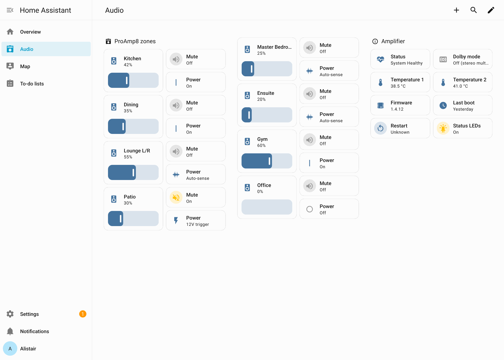
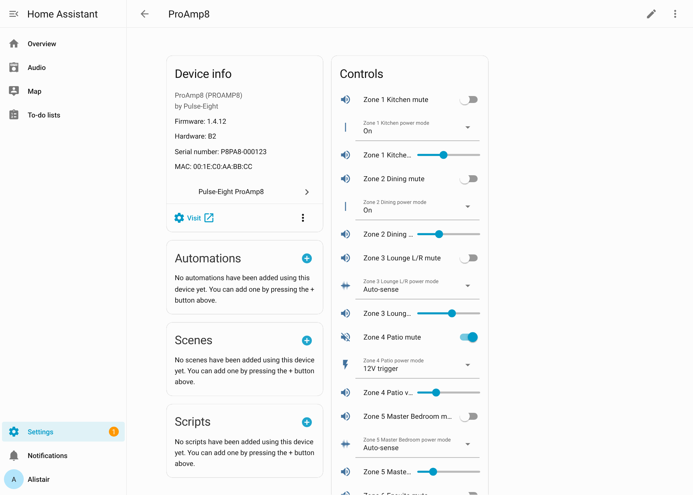
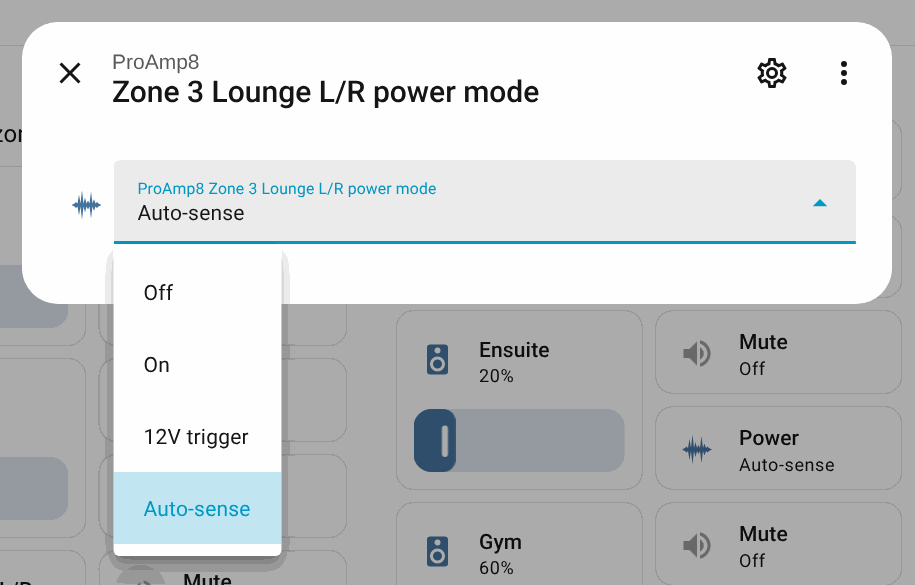
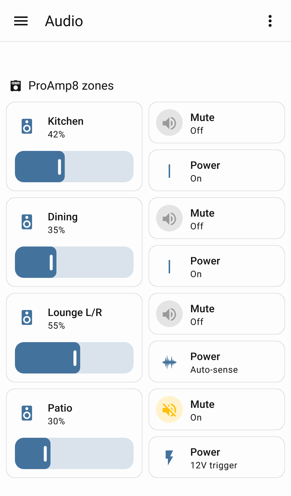

<p align="center"><a href="https://www.pulse-eight.com/p/219/proamp-8"></a></p>

# Pulse-Eight ProAmp8 for Home Assistant

[](https://hacs.xyz/docs/faq/custom_repositories) [](https://github.com/AlistairHA/HA-PulseEight-ProAmp/releases)  

Bring your **Pulse-Eight ProAmp8** amplifiers into Home Assistant: each amp becomes a device with a volume slider, mute switch and power mode for every one of its 8 zones, plus temperatures, firmware and health. It talks to the amp directly over your LAN; no cloud connection is needed.

[](https://my.home-assistant.io/redirect/hacs_repository/?owner=AlistairHA&repository=HA-PulseEight-ProAmp&category=integration)

## Highlights

- **Per-zone control**: volume (0–100 %), mute, and power mode (Off / On / 12V trigger / Auto-sense).
- **Uses your zone names** from the ProAmp web UI, e.g. *Zone 1 Kitchen volume*.
- **Health and hardware**: system status, four temperature sensors, last boot, Dolby mode, firmware, serial and MAC.
- **Multiple amps**: add as many as you have; each is its own device, identified by serial number.
- Works with the [neo matrix](https://github.com/AlistairHA/HA-PulseEight-NeoX) and [ProAudio](https://github.com/AlistairHA/HA-PulseEight-ProAudio) integrations.

## Screenshots

An example dashboard: a volume slider, mute and power mode for each zone, plus the amp's status (YAML below).



| The amp's device page | Picking a zone's power mode | On a phone |
|---|---|---|
|  |  |  |

<details>
<summary>Dashboard YAML for one zone (repeat for each zone)</summary>

Your entity IDs include the zone names you've set in the ProAmp web UI. Look them up on the device page if they differ.

```yaml
type: grid
cards:
  - type: tile
    entity: number.proamp8_zone_1_kitchen_volume
    name: Kitchen
    icon: mdi:speaker
    features:
      - type: numeric-input
        style: slider
    features_position: bottom
    grid_options: { columns: 6 }
  - type: tile
    entity: switch.proamp8_zone_1_kitchen_mute
    name: Mute
    grid_options: { columns: 3 }
  - type: tile
    entity: select.proamp8_zone_1_kitchen_power_mode
    name: Power
    grid_options: { columns: 3 }
```

</details>

## Supported hardware

<p align="center"><a href="https://www.pulse-eight.com/p/219/proamp-8"></a></p>

The [**ProAmp8**](https://www.pulse-eight.com/p/219/proamp-8): 8 amplified zones plus a Dolby digital input. Firmware that reports volume and power mode in its port list is used directly; older firmware is read zone by zone.

## What you get (per amplifier)

| Area | Entity | Type |
|---|---|---|
| System info | System status (the full `/System/Details` payload is attached as attributes) | sensor |
| | Dolby mode: Off / On 3-zone / On 4-zone | sensor (enum) |
| | Temperature 1–4 (internal sensors, °C) | sensor |
| | Last boot (worked out from the uptime counter) | sensor (diagnostic) |
| Hardware details | Model, Firmware version, Serial number | sensor (diagnostic) |
| | MAC address, Hardware revision (only if the firmware reports them) | sensor (diagnostic) |
| Per zone ×8 | **Zone N volume**, 0–100 % slider | number |
| | **Zone N power mode**: Off / On / 12V trigger / Auto-sense | select |
| | Zone N mute | switch |
| Maintenance | Restart | button |
| | Status LEDs (front panel; only if the firmware reports it) | switch (config) |

The device page also shows the manufacturer, model, firmware, hardware revision, serial number and MAC, and links to the amp's web UI. If you've named an output in the ProAmp web UI (for example "Kitchen"), that name is added to the entity name, as in `Zone 1 Kitchen volume`.

## Install

**HACS (recommended)**

1. Click the button below, or in HACS open **⋮ → Custom repositories** and add `https://github.com/AlistairHA/HA-PulseEight-ProAmp` as type **Integration**.

   [](https://my.home-assistant.io/redirect/hacs_repository/?owner=AlistairHA&repository=HA-PulseEight-ProAmp&category=integration)
2. Download **Pulse-Eight ProAmp8**, then restart Home Assistant.
3. Go to **Settings → Devices & services → Add integration → Pulse-Eight ProAmp8**.
   Enter the amp's IP address (a DHCP reservation is recommended). Repeat for each amplifier.

**Manual:** copy `custom_components/pulse_eight_proamp` into `<config>/custom_components/` and restart Home Assistant.

Updates appear under **Settings → Updates** whenever a new release is published.

## Setup

Each amp is identified by its serial number, so adding the same amp twice is rejected.

You can change these later:
- **Configure:** sets the polling interval (default 10 s, range 3–300 s).
- **Reconfigure:** updates the IP address. The amp's serial number is checked so a different unit isn't picked up by mistake.

## API used

| Purpose | Request |
|---|---|
| Model / serial / firmware / status | `GET /System/Details` |
| Temperatures / uptime | `GET /System/Health` |
| Per-zone volume, mute, power mode and names | `GET /Port/List` |
| Dolby mode | `GET /amp/dolbysettings` |
| Set volume | `GET /Amp/Volume/{zone}/{0-100}` |
| Mute / unmute | `GET /Amp/Mute/{zone}/3/{1\|0}` |
| Set power mode | `POST /Amp/StdZone {"zone":z,"power_mode":m}` (falls back to `pwrMode`) |
| Status LEDs | `GET /System/Features`, `POST /System/StatusLED/{On\|Off}` |
| Restart | `GET /System/Restart` |

Zones are numbered 0–7 in the API and shown as 1–8 in Home Assistant. These endpoints come from Pulse-Eight's published *ProAmp8 API Function Reference* and their open-source Control4/RTI drivers (github.com/Pulse-Eight/drivers).

The shared MatrixOS endpoints (`/System/*`, `/Port/List`) were also checked against Pulse-Eight's installer API docs (monitoring.pulse-eight.com/APIDocs). Those docs cover the matrix side only. They don't document any `/Amp/*` command, so the amp-specific calls still rely on the function reference and drivers above.

If the amp runs older firmware that leaves volume or power mode out of `/Port/List`, the integration reads them per zone from `/Amp/Volume/{zone}` and `/Amp/StdZone` instead.

## Notes
- **Dolby mode:** In Dolby 3-zone or 4-zone mode, zones 1–3 (or 1–4) carry the surround channels and share a single Dolby volume. Setting the volume on any of those zones changes the volume for the whole surround system.
- **Hardware fields:** The installer API docs give `MAC` and `BoardRev` (an integer board revision) in `/System/Details`, along with an integer `Status` code (0 = healthy). The integration uses those, and still accepts other names such as `HardwareRevision`. If those sensors don't appear, open **System status → Attributes** to see everything the amp reports. You can also use **Download diagnostics** on the device page: it gives the raw API responses with the serial number and MAC redacted. Attach that file to an [issue](https://github.com/AlistairHA/HA-PulseEight-ProAmp/issues) so the fields can be mapped.
- **Power mode:** "Off" turns the zone output off. "12V trigger" and "Auto-sense" are the amp's automatic standby modes. Auto-sense isn't supported on the Dolby digital input.

## Part of a family

These integrations share the same design, so their panels and entities look and behave alike:

| Integration | What it controls |
|---|---|
| [**neo:X+ matrix**](https://github.com/AlistairHA/HA-PulseEight-NeoX) | HDMI/HDBaseT video matrix: routing, CEC display control, link health |
| [**ProAudio DSP matrix**](https://github.com/AlistairHA/HA-PulseEight-ProAudio) | Multi-zone DSP audio matrix: routing, zone volume/mute/power, presets |

## Development
```bash
pip install pytest-homeassistant-custom-component
pytest
```
The tests run the integration inside Home Assistant against a stateful fake ProAmp8 (`tests/conftest.py`). They cover setup, every platform, the control round-trips, offline and recovery handling, the legacy-firmware fallbacks, and the config, options and reconfigure flows.

To try the integration without an amp, run the same fake as a real HTTP server with `python -m tests.sim --port 8090`, then add the integration with host `127.0.0.1:8090`. The screenshots above were taken that way.

### Releasing

HACS installs from GitHub releases. To publish a change, bump `version` in `custom_components/pulse_eight_proamp/manifest.json`, commit, then create a release with a matching tag (for example `v1.2.3`). The included *Release* workflow does this automatically when the version changes on `main` (if the `.github` folder is in the repo). Without any release, HACS shows *"'' is not a usable version"*.

---

Product images © Pulse-Eight Ltd, used with permission. This is an independent project and isn't made, supported or endorsed by Pulse-Eight or the Home Assistant project.
